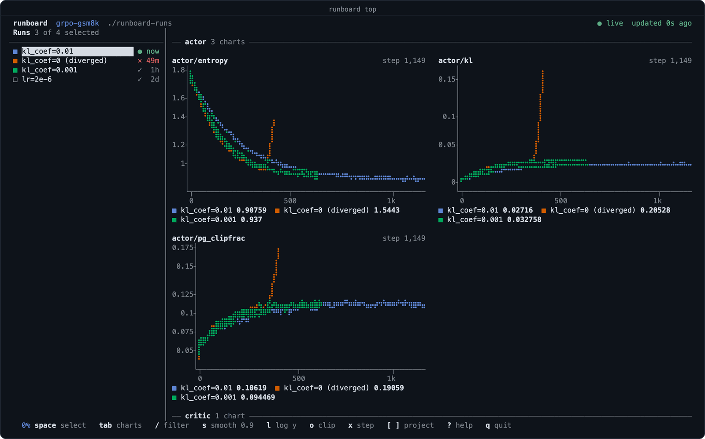
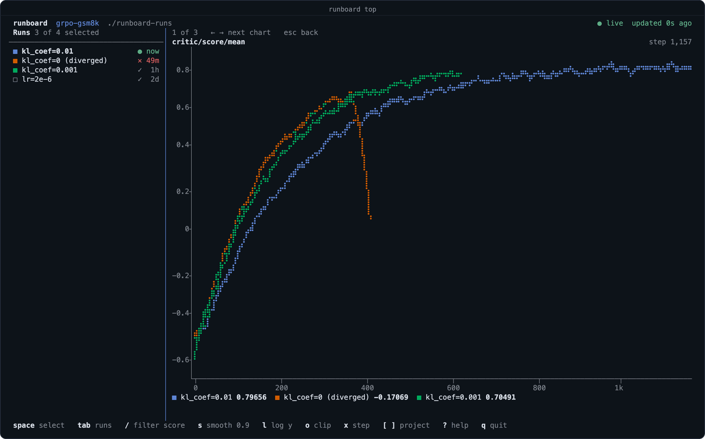
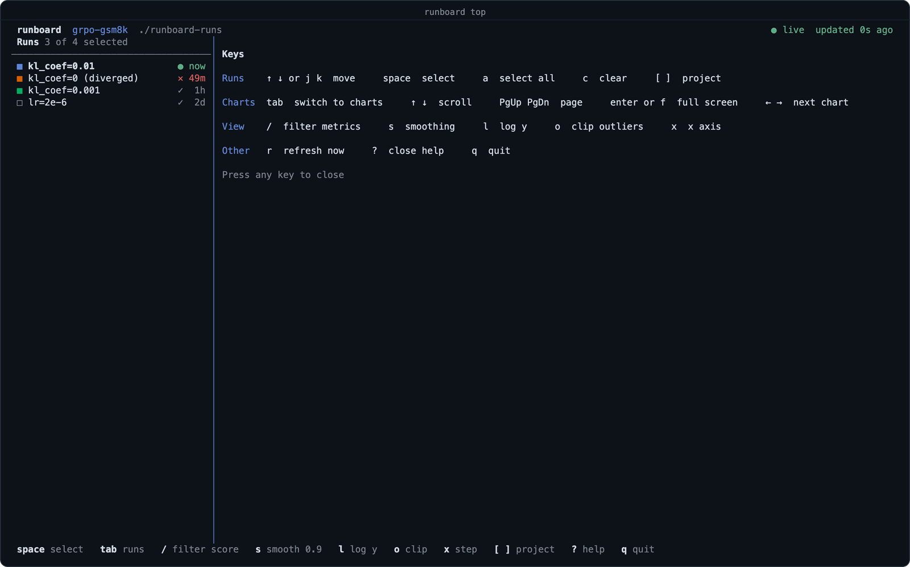
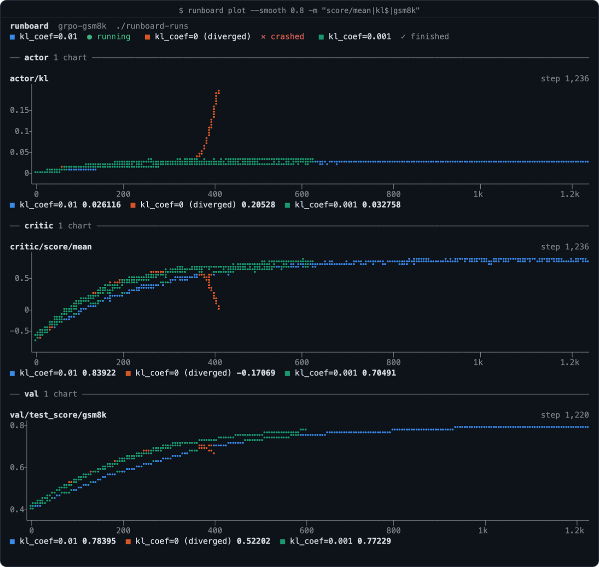

# Charts in the terminal

Runboard draws the same charts as the web dashboard in a terminal. Use it when a browser is out of reach
or just inconvenient: an SSH session on a login node, a tmux pane next to your training logs, a cluster
with no internet access, a CI log, or a coding agent that needs to see how a run is going.

- **`runboard top`** is live and full screen: runs on the left, charts on the right, driven from the
  keyboard and refreshed every 5 seconds.
- **`runboard plot`** prints the charts once and exits.

Both are part of the Python package and need only the standard library.



## Quick start

```bash
pip install runboard
runboard top
```

`top` opens on the project that logged most recently and selects its three most recent runs, the same
way the web dashboard does. Press <kbd>?</kbd> for every key and <kbd>q</kbd> to quit.

To print charts instead:

```bash
runboard plot                                        # the most recent runs of the most active project
runboard plot "lr=3e-4" "lr=1e-3" -m "loss|acc"      # chosen runs, chosen metrics
runboard plot --project resnet --smooth 0.8 --logy
```

## Where the data comes from

The terminal views read the same backend as `runboard ls`, in this order:

1. `--dir PATH` reads a runs directory directly, with no server involved.
2. `--server URL` with `--token`, or the token saved for that URL by `runboard configure`.
3. `RUNBOARD_DIR`, if it is set.
4. `RUNBOARD_SERVER` and `RUNBOARD_TOKEN`, or `~/.runboard/server.json`.
5. `./runboard-runs` when nothing is configured.

So after `runboard configure`, `runboard top` shows your Cloudflare runs on any machine that shares that
home directory. On an offline cluster that writes runs to shared storage, point it at the directory:

```bash
runboard top --dir /shared/$USER/runboard-runs
```

The header shows which source is in use: the server URL, or the directory as `./…` or `~/…` when it is
under the current directory or your home.

## `runboard top`



The screen has four parts:

| Part | What it shows |
|---|---|
| Header | Runboard, the current project, the data source, and `● live updated Ns ago`, or the error if a refresh failed |
| Runs | The project's runs, newest first. `■` marks a selected run in its chart color, `□` an unselected one, followed by its status and how long ago it last logged |
| Charts | One chart per metric, grouped into sections by prefix (`actor/`, `critic/`, `val/`). Under each chart, every selected run's latest value |
| Footer | Key hints with the current smoothing, log, clip, and x-axis settings, and how far the charts are scrolled |

Status marks: `●` running, `✓` finished, `✕` crashed or killed, and `!` stale, meaning a running job
that has not logged for 10 minutes.

### Keys

| Key | Action |
|---|---|
| <kbd>↑</kbd> <kbd>↓</kbd> or <kbd>j</kbd> <kbd>k</kbd> | Move through the run list |
| <kbd>space</kbd> or <kbd>enter</kbd> | Select or drop the run under the cursor (up to 8) |
| <kbd>a</kbd> | Select every run in the project, up to 8 |
| <kbd>c</kbd> | Clear the selection |
| <kbd>[</kbd> <kbd>]</kbd> | Previous or next project; after the last project comes all projects |
| <kbd>tab</kbd> | Move between the run list and the charts |
| <kbd>↑</kbd> <kbd>↓</kbd>, <kbd>PgUp</kbd> <kbd>PgDn</kbd>, <kbd>Home</kbd> <kbd>End</kbd> | Scroll the charts (when the charts have focus) |
| <kbd>f</kbd>, or <kbd>enter</kbd> when the charts have focus | Show the chart at the top of the view full screen |
| <kbd>←</kbd> <kbd>→</kbd> | In full screen, show the previous or next chart |
| <kbd>esc</kbd> | Leave full screen |
| <kbd>/</kbd> | Filter metrics with a regex; <kbd>enter</kbd> applies it, <kbd>esc</kbd> cancels. A pattern that is not a valid regex is matched as plain text |
| <kbd>s</kbd> | Cycle EMA smoothing: 0, 0.6, 0.8, 0.9, 0.95, 0.98 |
| <kbd>l</kbd> | Toggle a log-scale y axis |
| <kbd>o</kbd> | Toggle outlier clipping: the y axis covers the 1st to 99th percentile, so one spike does not flatten a curve |
| <kbd>x</kbd> | Switch the x axis between step, minutes since the run started, and clock time |
| <kbd>r</kbd> | Refresh now |
| <kbd>?</kbd> | Show or hide help |
| <kbd>q</kbd> | Quit |



### Options

| Option | Default | Meaning |
|---|---|---|
| `RUN …` | the most recent runs | Runs to select at start, by name, id, or `project/id`. A partial name selects every run that contains it |
| `--project NAME` | the most recently active | Start on this project |
| `-m`, `--metric REGEX` | all metrics | Start with this metric filter |
| `--smooth A` | `0` | Start with EMA smoothing `A`, between 0 and 0.99 |
| `--logy`, `--clip` | off | Start with log y or outlier clipping on |
| `--x step\|minutes\|time` | `step` | Start with this x axis |
| `--interval SECONDS` | `5` | Time between refreshes |
| `--dir`, `--server`, `--token` | configured | Where to read runs from (see above) |

`top` needs an interactive terminal of at least 60 × 14 characters; it asks you to enlarge a smaller
window rather than squeezing the charts. Charts sit side by side when the terminal is wide enough, and a
section with a single chart uses the full width.

## `runboard plot`



`plot` takes the same run arguments and options as `top` except `--interval`, plus:

| Option | Default | Meaning |
|---|---|---|
| `--width COLUMNS` | the terminal width | Total width of the output |
| `--height ROWS` | `12` | Height of each chart |
| `--columns N` | fits the width | Charts per row |
| `--color auto\|always\|never` | `auto` | `auto` colors only when writing to a terminal, and respects `NO_COLOR` and `TERM=dumb` |

It exits with status 1 and a one-line reason when there are no runs, when a named run does not exist,
or when no metric matches the filter.

## Recipes

**From your laptop, over SSH.** `top` needs a terminal, so ask SSH for one:

```bash
ssh -t login-node runboard top
```

**Next to a training job in tmux.** Split the window and run `runboard top --project my-project` in the
second pane; it follows the job as it logs.

**Final curves in a Slurm log.** Give the run a known id, then print its charts at the end of the job
script so they land in the `.out` file:

```bash
runboard run --project resnet --run-id "job-$SLURM_JOB_ID" -- python train.py
runboard plot "job-$SLURM_JOB_ID" --color never --width 120
```

**Coding agents.** After wiring a job to Runboard, an agent can run
`runboard plot <run> --color never` to check that the metrics have the expected names and shapes.

## Limits

- Relationship charts declared with `runboard_binned_charts` are drawn only in the web dashboard. Their
  per-bin series stay hidden in the terminal unless a metric filter asks for them, for example `-m bin_`.
- Each character cell can show one color, so where two runs cross the same cell, the run drawn later
  wins that cell.
- `top` uses `curses`, which macOS and Linux include and Windows Python does not. On Windows, use
  `runboard plot` or WSL.

## Troubleshooting

| Symptom | Fix |
|---|---|
| Boxes or question marks instead of lines | The terminal font has no braille characters (U+2800 to U+28FF). Most modern monospace fonts, such as SF Mono, Menlo, JetBrains Mono, Cascadia Code, and DejaVu Sans Mono, include them or fall back cleanly |
| No colors, or the wrong ones | Check that `TERM` names a color terminal, for example `xterm-256color`, and that `NO_COLOR` is not set. Set `COLORTERM=truecolor` to give `plot` exact colors |
| `runboard top needs an interactive terminal` | Run it in a terminal; over SSH add `-t`. Use `runboard plot` in scripts and pipes |
| The header shows an error instead of `● live` | The server could not be reached or rejected the token. The charts keep the last data; `runboard doctor` shows what is wrong |
| `Make the terminal larger` | Enlarge the window to at least 60 × 14 |
